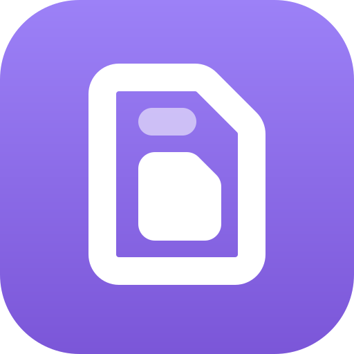
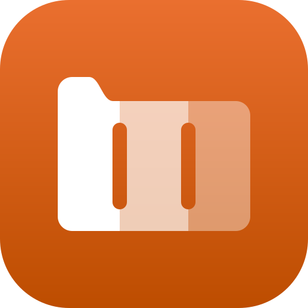
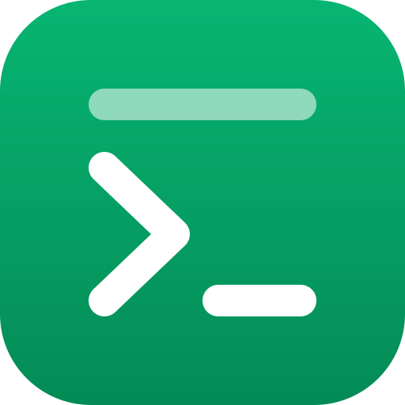

# Robert's Obsidian Plugins

Plugins I built for my Obsidian vault. Each folder has the plugin's code and a README.

| | Plugin | What it does |
|:-:|---|---|
|  | **[BetterNotes](BetterNotes)** | Notion-style notes that can hold attachments and sub-notes. |
|  | **[FolderPalette](FolderPalette)** | Folder colors, icons, collapse arrows and tree lines for the file explorer. |
|  | **[ImageGrip](ImageGrip)** | Drag a corner to resize images in Live Preview, and copy them with Ctrl+C. |
|  | **[ReminderSuite](ReminderSuite)** | Two-way Google Calendar sync for tasks, with a calendar view and a reminder sidebar. |
|  | **[RobTerminal](RobTerminal)** | A real Windows terminal inside Obsidian, built on ConPTY and xterm.js. |
